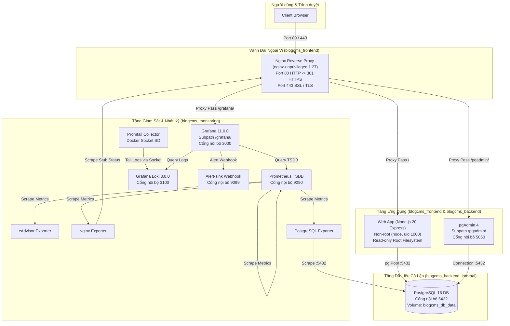
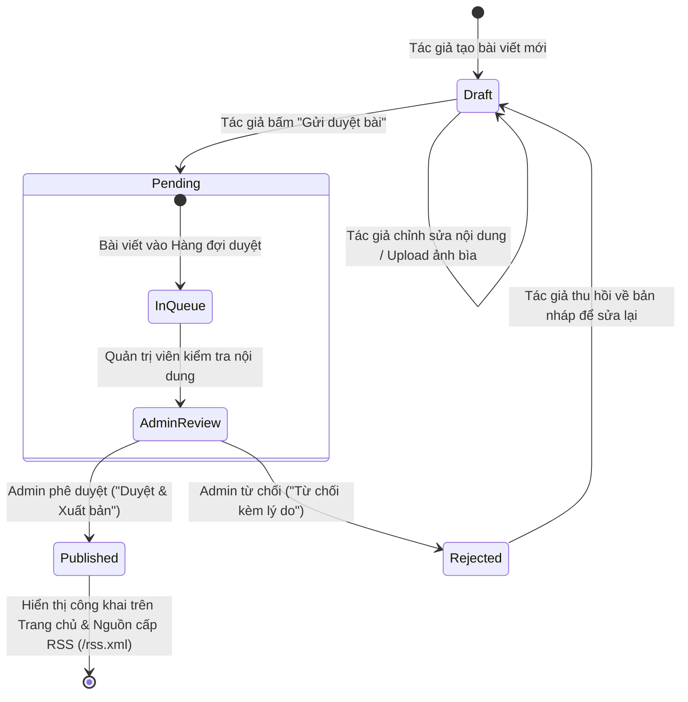

# DTC245180035-blogcms-devops

Hệ thống Blog / CMS (Quản trị nội dung nhiều tác giả) phục vụ bài tập lớn môn **Triển khai và Quản trị Hệ thống Phần mềm (DevOps)**.

- **Sinh viên thực hiện**: Hà Đức Trung
- **Mã số sinh viên (MSSV)**: DTC245180035
- **Email**: lazyassbone@gmail.com
- **Môi trường triển khai**: Docker Desktop v4.30+ (WSL2 Ubuntu 22.04 LTS), Windows 11 Host
- **Kho mã nguồn GitHub**: `DTC245180035-blogcms-devops`

---

## 1. Giới thiệu Đề tài Blog / CMS Đa Tác Giả

Dự án xây dựng một nền tảng quản trị nội dung (CMS) và blog công nghệ hỗ trợ nhiều tác giả theo kiến trúc Microservices hiện đại đóng gói trong Docker. Hệ thống đáp ứng đầy đủ các tiêu chuẩn bảo mật doanh nghiệp, kiểm soát truy cập dựa trên vai trò (RBAC), quy trình biên tập và xuất bản bài viết chặt chẽ, hạ tầng giám sát thời gian thực (Prometheus + Grafana) và quản lý nhật ký tập trung (Loki + Promtail).

### Tính năng Nổi bật
- **Phân quyền người dùng (RBAC 3 cấp)**: Độc giả (Member), Tác giả (Author), Quản trị viên (Admin).
- **Quy trình xuất bản nội dung**: Quản lý vòng đời bài viết từ Nháp (Draft) -> Chờ duyệt (Pending) -> Xuất bản (Published) hoặc Từ chối (Rejected).
- **Bảo mật ứng dụng toàn diện**: Chống SQL Injection (Parameter queries), XSS (DOMPurify/Sanitization), CSRF (Double-submit token), kiểm tra chữ ký nhị phân ảnh upload (Magic Bytes), Cookie an toàn (`HttpOnly`, `SameSite=Strict`, `Secure`).
- **An ninh mạng & Gateway**: Nginx Reverse Proxy không đặc quyền (`nginx-unprivileged`), SSL/TLS termination, HTTP/2, Rate Limiting chống Brute Force / DoS, cấu hình đầy đủ Security Headers (HSTS, CSP, X-Frame-Options, X-Content-Type-Options).
- **Phân tách mạng 3 tầng (Network Segmentation)**: `frontend`, `backend` (`internal: true`), và `monitoring`. Database PostgreSQL hoàn toàn cô lập trong mạng backend.
- **Giám sát & Nhật ký**: Thu thập metrics (Nginx, PostgreSQL, cAdvisor, Prometheus) và trực quan hóa qua 4 Dashboards Grafana; ghi log tập trung với Grafana Loki và Promtail; hệ thống cảnh báo tấn công an ninh tự động qua Webhook Alert-sink.
- **Gia cố an toàn (Hardening)**: 100% container tuân thủ CIS Docker Benchmark (chạy user không đặc quyền, `read_only: true` root filesystem, `cap_drop: [ALL]`, `no-new-privileges:true`, giới hạn tài nguyên CPU/RAM, quét sạch lỗ hổng Trivy).

---

## 2. Sơ đồ Kiến trúc Hệ thống & Vòng Đời Bài Viết

### 2.1. Sơ đồ Kiến trúc Mạng & Dịch vụ (Architecture Diagram)



---

### 2.2. Sơ đồ Quy trình Vòng Đời Bài Viết (Post State Machine)



---

## 3. Yêu Cầu Hệ Thống & Chuẩn Bị Môi Trường

### Yêu Cầu Tối Thiểu
- **Hệ điều hành**: Windows 10/11 64-bit (chạy WSL2) hoặc Linux Ubuntu 22.04 LTS.
- **Phần mềm điều phối**: Docker Desktop v4.30+ (hoặc Docker Engine v24.0+ & Docker Compose v2.20+).
- **WSL 2**: Đã bật tích hợp `Use the WSL 2 based engine` và cấu hình phân bổ tài nguyên:
  - **RAM**: Tối thiểu 4 GB (Khuyến nghị 6 GB - 8 GB).
  - **CPU**: Tối thiểu 2 Cores (Khuyến nghị 4 Cores).
  - **Ổ cứng**: Còn trống tối thiểu 15 GB.
- **Tiện ích dòng lệnh**: `bash`, `openssl`, `curl`, `git`.

---

## 4. Hướng Dẫn Cài Đặt & Chạy "Một Lệnh"

### Bước 1: Sao chép kho mã nguồn (Clone)
Mở terminal trong WSL2 (Ubuntu 22.04) và clone kho mã nguồn:
```bash
git clone https://github.com/lazyassbone/DTC245180035-blogcms-devops.git ~/blogcms
cd ~/blogcms
```

### Bước 2: Thiết lập Biến Môi Trường
Sao chép tệp mẫu `.env.example` thành `.env`:
```bash
cp .env.example .env
```
> [!NOTE]
> File `.env` chứa các bí mật vận hành như `POSTGRES_PASSWORD`, `SESSION_SECRET`, `GRAFANA_ADMIN_PASSWORD`, `PGADMIN_DEFAULT_PASSWORD`. Các giá trị mặc định trong `.env.example` đã được định hình sẵn sàng cho môi trường kiểm thử. Không chia sẻ file `.env` lên kho công khai.

### Bước 3: Sinh Chứng chỉ SSL/TLS Tự Ký
Thực thi script sinh chứng chỉ khóa riêng RSA 2048-bit và chứng chỉ x509:
```bash
bash nginx/gen-cert.sh
```
*Tùy chọn*: Nếu muốn truy cập từ máy khác trong mạng LAN, truyền thêm địa chỉ IP LAN của máy Windows:
```bash
bash nginx/gen-cert.sh 192.168.1.100
```

### Bước 4: Khởi Động Toàn Bộ 12 Dịch Vụ
Khởi động hệ thống bằng Docker Compose v2:
```bash
docker compose up -d --build
```

Kiểm tra trạng thái sẵn sàng của toàn bộ 12 containers:
```bash
docker compose ps
```
*(Đảm bảo tất cả 12 container đều ở trạng thái `running` hoặc `healthy`)*.

---

## 5. Bảng Địa Chỉ Truy Cập Dịch Vụ & Tài Khoản Kiểm Thử

| Dịch vụ | Giao thức & URL | Mô tả chức năng |
|---|---|---|
| **Blog / CMS Web App** | `https://localhost` | Trang chủ Blog công nghệ, đọc bài viết |
| **Bàn làm việc Tác giả** | `https://localhost/author/dashboard` | Tác giả soạn thảo Markdown và gửi duyệt |
| **Hàng đợi duyệt (Admin)** | `https://localhost/admin/queue` | Quản trị viên xét duyệt, xuất bản / từ chối |
| **Quản trị CSDL (pgAdmin)** | `https://localhost/pgadmin/` | Giao diện quản trị PostgreSQL qua Web |
| **Hệ thống Giám sát Grafana**| `https://localhost/grafana/` | Bảng điều khiển metrics & logs (4 Dashboards) |
| **Máy chủ Giám sát Prometheus**| `http://localhost:9090` | Thu thập metrics, giám sát trạng thái 4 targets |
| **Nguồn cấp RSS Feed** | `https://localhost/rss.xml` | Nguồn cấp tin RSS 2.0 chuẩn XML |
| **Healthcheck Endpoint** | `https://localhost/health` | Kiểm tra kết nối CSDL (Trả về HTTP 200 OK) |

> [!IMPORTANT]
> **Cảnh báo chứng chỉ tự ký trên trình duyệt**:
> Do chứng chỉ SSL được sinh tự ký nội bộ cho môi trường phát triển, trình duyệt Chrome/Edge sẽ hiển thị cảnh báo `Your connection is not private`. Bấm **Advanced (Nâng cao)** -> Chọn **Proceed to localhost (unsafe) / Tiếp tục truy cập localhost** để vào giao diện.

### Tài Khoản Kiểm Thử Mặc Định (Đã Seed Sẵn Trong CSDL)

| Vai trò | Tên đăng nhập (Username) | Mật khẩu truy cập | Mục đích sử dụng |
|---|---|---|---|
| **Quản trị viên (Admin)** | `admin` | `123456` | Quản trị hệ thống, phê duyệt / từ chối bài viết |
| **Tác giả 1 (Author)** | `tacgia01` | `123456` | Soạn bài viết mới, gửi duyệt, quản lý bài cá nhân |
| **Tác giả 2 (Author)** | `tacgia02` | `123456` | Soạn thảo và phối hợp đa tác giả |
| **Độc giả 1 (Member)** | `docgia01` | `123456` | Đọc bài viết, bình luận, tương tác cộng đồng |
| **Độc giả 2 (Member)** | `docgia02` | `123456` | Đọc bài viết và gửi phản hồi |
| **Quản trị pgAdmin** | `pgadmin4@pgadmin.org` | `123456` | Đăng nhập giao diện web pgAdmin 4 |
| **Quản trị Grafana** | `admin` | `123456` | Đăng nhập bảng điều khiển Grafana |

---

## 6. Hướng Dẫn Demo Theo Từng Vai Trò Người Dùng

### 6.1. Dành Cho Độc Giả (Member / `docgia01`)
1. Truy cập `https://localhost/login` và đăng nhập bằng tài khoản `docgia01`.
2. Truy cập Trang chủ `https://localhost/` để xem danh sách bài viết đã xuất bản (`published`).
3. Tìm kiếm bài viết bằng thanh tìm kiếm: nhập từ khóa `Docker` hoặc `DevOps`.
4. Bấm vào một bài viết chi tiết, kéo xuống phần bình luận:
   - Nhập nội dung bình luận và bấm **Gửi bình luận**.
   - Bình luận được làm sạch chống tấn công XSS và hiển thị ngay lập tức.
5. Kiểm tra nguồn cấp tin tức: Mở `https://localhost/rss.xml` trên trình duyệt hoặc trình đọc RSS để xem danh mục tin tức chuẩn RSS 2.0.

### 6.2. Dành Cho Tác Giả (Author / `tacgia01`)
1. Truy cập `https://localhost/login` và đăng nhập bằng tài khoản `tacgia01`.
2. Vào **Bàn làm việc Tác giả** tại `https://localhost/author/dashboard`.
3. Bấm **Viết bài mới** (`https://localhost/author/posts/new`):
   - Nhập tiêu đề bài viết: `Hướng Dẫn Tối Ưu Hóa Container Với Docker Multi-stage Build`.
   - Chọn thể loại (tags) và nhập tóm tắt.
   - Tải lên ảnh bìa đại diện (File JPEG/PNG hợp lệ có Magic Bytes chuẩn).
   - Soạn thảo nội dung định dạng Markdown.
4. Chọn hành động:
   - **Lưu nháp**: Bài viết ở trạng thái `draft`, chỉ tác giả nhìn thấy và chỉnh sửa tiếp.
   - **Gửi duyệt bài**: Bài viết chuyển sang trạng thái `pending` và chuyển tiếp vào Hàng đợi duyệt của Quản trị viên.
5. Theo dõi bài viết: Nếu Quản trị viên từ chối, bài viết chuyển sang trạng thái `rejected` kèm lý do giải trình; tác giả có thể bấm thu hồi về `draft` để sửa và gửi duyệt lại.

### 6.3. Dành Cho Quản Trị Viên (Admin / `admin`)
1. Truy cập `https://localhost/login` và đăng nhập bằng tài khoản `admin`.
2. Truy cập **Hàng đợi duyệt bài** tại `https://localhost/admin/queue`.
3. Xem danh sách các bài viết đang ở trạng thái `pending`:
   - Bấm **Xem trước** để kiểm tra nội dung và tính an toàn của bài viết.
   - Bấm **Duyệt & Xuất bản**: Bài viết lập tức chuyển sang trạng thái `published`, xuất hiện ngoài Trang chủ và tự động đồng bộ vào RSS Feed.
   - Hoặc bấm **Từ chối**: Nhập lý do từ chối (ví dụ: *Cần bổ sung nguồn tham khảo*). Bài viết chuyển về trạng thái `rejected`.

---

## 7. Hướng Dẫn Chụp Ảnh Prometheus Targets Phục Vụ Báo Cáo

Cổng 9090 của Prometheus được cô lập hoàn toàn trong mạng nội bộ `blogcms_monitoring` nhằm đảm bảo an ninh mạng. Để chụp ảnh màn hình trang **Prometheus Targets** (`http://localhost:9090/targets`):

1. Tạo file ghi đè cổng tạm thời `docker-compose.override.yml`:
   ```yaml
   services:
     prometheus:
       ports:
         - "127.0.0.1:9090:9090"
   ```
2. Cập nhật dịch vụ Prometheus:
   ```bash
   docker compose up -d prometheus
   ```
3. Mở trình duyệt truy cập: `http://localhost:9090/targets` và chụp ảnh 4 targets (`cAdvisor`, `Nginx`, `Postgres`, `Prometheus`) đều đạt trạng thái `UP (1/1)`.
4. Gỡ bỏ cổng và khôi phục chế độ cô lập an toàn:
   ```bash
   rm -f docker-compose.override.yml
   docker compose up -d prometheus
   ```

---

## 8. Lệnh Chạy Kịch Bản Kiểm Thử Bảo Mật & Tải

### 8.1. Kiểm Thử Tấn Công Dò Quét Mật Khẩu (Brute Force) & Cảnh Báo An Ninh
Kịch bản mô phỏng kẻ tấn công gửi liên tiếp 20 yêu cầu đăng nhập sai vào endpoint `/login`:
```bash
bash scripts/simulate_bruteforce.sh
```
- **Kết quả kỳ vọng**:
  - Nginx Rate Limiting kích hoạt cơ chế phòng thủ, trả về mã trạng thái `HTTP 429 Too Many Requests`.
  - Web app ghi nhận log sự kiện bảo mật `LOGIN_FAILED`.
  - Promtail thu thập log và đẩy về Loki.
  - Grafana Alerting kích hoạt cảnh báo `WebappLoginBruteforceDetected` và gửi Webhook tới `alert-sink` (Port 9099).

### 8.2. Quét Lỗ Hổng Bảo Mật Container Bằng Trivy
Chạy công cụ quét lỗ hổng Trivy v0.50.2 tiêu chuẩn quốc tế:
```bash
bash scripts/run_trivy_scan.sh
```
- **Kết quả kỳ vọng**: Image tự xây dựng (`blogcms-web:latest` và `blogcms-alert-sink:latest`) đạt **0 lỗ hổng CRITICAL** và **0 lỗ hổng HIGH**.

### 8.3. Kiểm Thử Hiệu Năng & Tải (Stress / Load Test)
Kiểm thử khả năng chịu tải của Nginx Reverse Proxy và Web app bằng ApacheBench hoặc Dockerized tool:
```bash
# Kiểm thử tải 1000 requests, đồng thời 20 kết nối qua HTTPS:
docker run --rm --net=host httpd:alpine ab -n 1000 -c 20 -k https://127.0.0.1/
```

### 8.4. Kiểm Thử Tự Động Toàn Diện Từ Trạng Thái Sạch (Clean Verification)
Kiểm tra tính toàn vẹn và khả năng tự động triển khai độc lập của hệ thống:
```bash
bash scripts/test_clean_environment.sh
```
*(Script tự động clone ra môi trường độc lập, khởi tạo, kiểm tra 100% chức năng và thu thập bằng chứng vào `evidence/final-smoke-test.txt`)*.

---

## 9. Hướng Dẫn Dừng & Dọn Dẹp Hệ Thống

### Trường Hợp 1: Dừng Tạm Thời (Bảo Toàn Dữ Liệu)
Khi muốn tạm dừng dịch vụ nhưng **giữ nguyên toàn bộ bài viết, người dùng và dữ liệu giám sát**:
```bash
docker compose stop
# Hoặc:
docker compose down
```
*(Dữ liệu được lưu trữ an toàn trong các Docker named volumes: `blogcms_db_data`, `prometheus_data`, `grafana_data`, `loki_data`)*.

### Trường Hợp 2: Xóa Sạch Hoàn Toàn (Factory Reset)
Khi muốn xóa bỏ hoàn toàn tất cả containers, mạng ảo và **xóa sạch toàn bộ dữ liệu volumes**:
```bash
docker compose down -v --rmi local
```

### Trường Hợp 3: Giải Phóng Bộ Nhớ RAM Máy Host Windows
Sau khi dừng Docker, để giải phóng hoàn toàn tài nguyên RAM đang bị máy ảo WSL2 chiếm dụng:
```powershell
# Chạy trong PowerShell (Run as Administrator) trên Windows:
wsl --shutdown
```

---

## 10. Hướng Dẫn Xử Lý Các Sự Cố Thường Gặp (Troubleshooting)

### 10.1. Xung Đột Cổng 80 hoặc 443 Trên Windows Host
- **Hiện tượng**: `docker compose up -d` báo lỗi `bind: address already in use` trên cổng 80 hoặc 443.
- **Nguyên nhân**: Dịch vụ IIS (Internet Information Services), World Wide Web Publishing Service (`w3svc`), hoặc Skype/VMware trên Windows đang chiếm dụng cổng.
- **Cách khắc phục**:
  1. Mở PowerShell (Admin) trên Windows kiểm tra PID đang chiếm cổng:
     ```powershell
     netstat -ano | findstr :80
     netstat -ano | findstr :443
     ```
  2. Tạm dừng dịch vụ IIS nếu đang chạy:
     ```powershell
     Stop-Service -Name W3SVC -Force
     ```

### 10.2. Lỗi Quyền Đọc File Khóa Bí Mật SSL (`server.key`)
- **Hiện tượng**: Container `nginx` rơi vào vòng lặp CrashLoopBackOff, log báo `Permission denied: calling fopen(/etc/nginx/certs/server.key)`.
- **Nguyên nhân**: Container Nginx chạy dưới người dùng không đặc quyền `nginx` (uid 101). Nếu file khóa riêng được đặt quyền `chmod 600`, user 101 sẽ không có quyền đọc.
- **Cách khắc phục**:
  Chạy lệnh cấp quyền đọc an toàn cho file chứng chỉ trong WSL:
  ```bash
  chmod 644 nginx/certs/server.key
  docker compose restart nginx
  ```

### 10.3. Lỗi Quyền Ghi Volume Khi Chạy Container Non-Root
- **Hiện tượng**: Web app báo lỗi `EROFS: read-only file system` hoặc không thể lưu ảnh bìa bài viết.
- **Nguyên nhân**: Tính năng Hardening thiết lập `read_only: true` cho root filesystem của container.
- **Cách khắc phục**:
  Đảm bảo thư mục lưu trữ ảnh được mount riêng qua volume `blogcms_uploads` tại `/app/public/uploads` và cấp quyền sở hữu cho người dùng `node` (uid 1000).

---

## 11. Cấu Trúc Thư Mục Kho Mã Nguồn

```
blogcms/
├── .env.example                     # Mẫu cấu hình biến môi trường
├── .gitattributes                   # Quy định chuẩn hóa xuống dòng LF
├── .gitignore                       # Danh sách loại trừ tệp nhạy cảm
├── README.md                        # Tài liệu hướng dẫn sử dụng toàn diện
├── docker-compose.yml               # Điều phối 12 dịch vụ, 3 networks, 7 volumes
├── alert-sink/                      # Microservice tiếp nhận Webhook cảnh báo
│   ├── Dockerfile
│   └── app.py
├── db/                              # Script khởi tạo CSDL PostgreSQL
│   └── init.sql
├── docs/                            # Tài liệu phân tích và báo cáo
│   ├── cho-bao-cao.md               # Tài liệu chi tiết tổng hợp cho 6 chương báo cáo
│   ├── phien-ban.md                 # Bảng tổng hợp phiên bản và thông số kỹ thuật
│   └── su-co-bruteforce.md          # Báo cáo kịch bản sự cố và truy vết LogQL
├── evidence/                        # Bằng chứng kiểm thử thực nghiệm (8 tệp .txt)
│   ├── buoc0-moitruong.txt
│   ├── buoc12-web-db.txt
│   ├── buoc3-nginx.txt
│   ├── buoc4-giamsat.txt
│   ├── buoc5-logql.txt
│   ├── buoc5-sucodo.txt
│   ├── buoc6-trivy.txt
│   └── final-smoke-test.txt
├── grafana/                         # Cấu hình Provisioning Datasources & Dashboards
│   └── provisioning/
├── loki/                            # Cấu hình Grafana Loki 3.0.0
│   └── loki-config.yaml
├── nginx/                           # Cấu hình Nginx & Script sinh chứng chỉ SSL
│   ├── nginx.conf
│   └── gen-cert.sh
├── prometheus/                      # Cấu hình Prometheus 2.52.0 Scrape Targets
│   ├── prometheus.yml
│   └── alert_rules.yml
├── promtail/                        # Cấu hình Promtail thu thập log container
│   └── promtail-config.yaml
├── scripts/                         # Các script tự động hóa kiểm thử và bảo mật
│   ├── run_trivy_scan.sh
│   ├── setup_postgres_exporter.sh
│   ├── simulate_bruteforce.sh
│   └── test_clean_environment.sh
└── web/                             # Mã nguồn ứng dụng Web Node.js (Express + EJS)
    ├── Dockerfile
    ├── package.json
    └── src/
```
